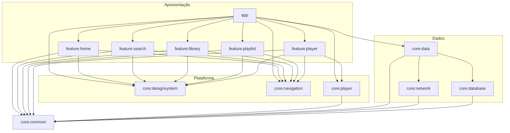
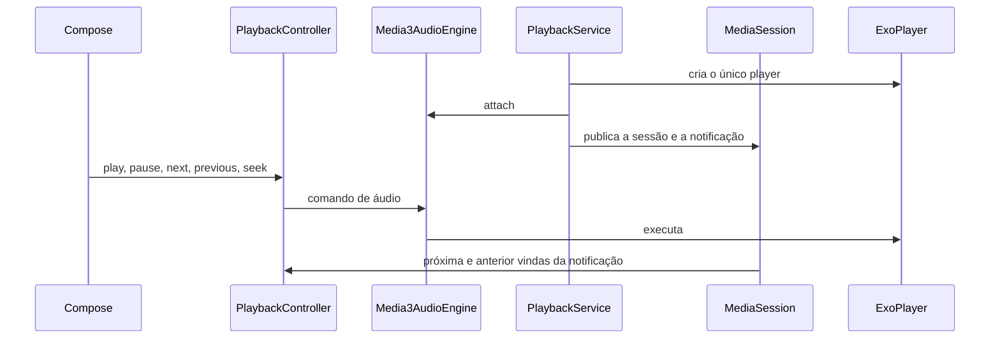

# MusicFlow

MusicFlow é um player de música nativo para Android. O aplicativo consulta o catálogo público da [Jamendo](https://www.jamendo.com/), reproduz o áudio por streaming e guarda no aparelho a biblioteca do usuário: favoritos, playlists e histórico.

O projeto é um portfólio de desenvolvimento Android. A base cobre modularização, Clean Architecture, MVVM, paginação, cache offline e reprodução em segundo plano com AndroidX Media3.

| | |
| --- | --- |
| Pacote | `br.com.musicflow` |
| `minSdk` | 24 |
| `compileSdk` / `targetSdk` | 37 |
| Linguagem | Kotlin 2.2.10 |
| Interface | Jetpack Compose e Material 3 |

## Demonstração

As capturas abaixo ainda não estão no repositório. Grave as telas em um aparelho ou emulador e salve os arquivos em `docs/demo/` com estes nomes. A pasta já existe. Enquanto os arquivos não forem adicionados, esta seção não exibe imagem.

| Arquivo | Conteúdo |
| --- | --- |
| `docs/demo/home.png` | Home, com saudação, artistas, álbuns, populares, recentes e playlists |
| `docs/demo/search.png` | Busca, com faixas e artistas |
| `docs/demo/library.png` | Biblioteca, nas abas Favoritos, Playlists e Recentes |
| `docs/demo/playlist.png` | Detalhe de uma playlist |
| `docs/demo/now-playing.png` | Tela Tocando agora |
| `docs/demo/mini-player.png` | Mini player sobre a navegação inferior |
| `docs/demo/playback.gif` | Reprodução, troca de faixa e continuidade com o app em segundo plano |

Depois de incluir os arquivos, publique as imagens com este bloco:

```markdown


```

## Funcionalidades

### Home

A Home cumprimenta conforme o período do dia e mostra artistas em destaque, álbuns populares, faixas populares paginadas, faixas recentes e playlists locais. Cada seção tem estado de carregamento, vazio e erro. Tocar uma faixa inicia a reprodução e abre a rota da faixa. Tocar um artista, um álbum ou uma playlist abre a rota correspondente.

### Busca

A busca espera 300 ms, descarta o termo anterior e cancela a paginação que ainda estiver em andamento. Termo vazio não chama a API. O mesmo termo não reinicia a lista. O resultado traz faixas paginadas e até 20 artistas. A tela cobre o estado inicial, carregamento, lista vazia, erro e nova tentativa. Tocar uma faixa reproduz e abre a rota da faixa.

### Biblioteca

A biblioteca tem três abas locais:

- Favoritos, com inclusão e remoção.
- Playlists, com criação e abertura.
- Recentes, com a opção de favoritar a faixa.

Favoritar exige que a faixa já esteja no cache do catálogo.

### Playlists

No detalhe dá para reproduzir a playlist, incluir faixas que já estão no cache, remover uma faixa, renomear e excluir a playlist. Nome em branco e faixa repetida são rejeitados. Se alguma faixa não puder ser carregada, a playlist continua na tela e o erro fica visível. Uma playlist vazia explica que não há o que reproduzir.

O histórico local recebe a primeira faixa quando a reprodução começa por essa tela.

### Player

A tela Tocando agora e o mini player observam o mesmo `MusicPlayback`. A posição fica em um `StateFlow` separado, para não recompor o restante da tela a cada atualização.

Os controles implementados são play, pause, próxima, anterior, seek, shuffle, repetição e fila. A anterior, depois de 3 segundos de reprodução, volta ao início da faixa atual. A repetição percorre `Off`, `All` e `One`. `One` reinicia a faixa quando ela termina. O botão de próxima avança. O shuffle mantém a faixa atual e embaralha o restante. Uma URL de stream inválida registra a falha e mantém o áudio que já estava tocando.

O mini player permanece fora do `NavHost`, some na tela Tocando agora e acompanha a navegação entre Início, Busca e Biblioteca.

### O que a interface ainda mostra só como identificador

As rotas de detalhe de faixa, artista e álbum existem e recebem o id, mas a tela correspondente mostra esse identificador. Ainda não há a ficha completa, a discografia nem a lista de faixas do artista. A paginação `tracksByArtist` já está na camada de dados.

## Tecnologias

| Tecnologia | Versão | Responsabilidade |
| --- | --- | --- |
| Kotlin | 2.2.10 | Linguagem e coroutines (`1.10.2`) |
| Android Gradle Plugin | 9.4.1 | Build Android, com Kotlin embutido no plugin |
| Gradle | 9.6.0 | Wrapper, configuration cache e daemon em JDK 25 |
| Jetpack Compose | BOM `2026.02.01` | UI, Material 3 e testes de interface |
| Navigation Compose | 2.10.2 | Rotas type-safe |
| Koin | 4.1.1 | Injeção de dependências |
| Retrofit | 2.11.0 | Cliente HTTP da Jamendo |
| OkHttp | 4.12.0 | Cliente HTTP e MockWebServer nos testes |
| kotlinx.serialization | 1.9.0 | JSON da API e rotas |
| Room | 2.8.5 | Banco local, com KSP `2.2.10-2.0.2` |
| Paging 3 | 3.3.6 | Catálogo e busca de faixas |
| Media3 | 1.11.1 | ExoPlayer, MediaSession e MediaSessionService |
| Coil | 3.3.0 | Capas e imagens |
| JUnit | 4.13.2 | Testes unitários |
| MockK | 1.14.5 | Dublês dos contratos |
| Turbine | 1.2.1 | Asserções de `Flow` |
| Robolectric | 4.16.1 | Testes de Compose na JVM |

O bytecode do projeto tem alvo JVM 11. O Gradle roda em JDK 25.

## Arquitetura

O código segue Clean Architecture e MVVM.

- O domínio, em `core:common`, define entidades, regras, contratos de repositório e casos de uso. É um módulo Kotlin JVM. Não depende de Android, Compose, Retrofit nem Room. Usa coroutines, Koin e `paging-common`, para os contratos paginados exporem `PagingData`.
- A camada de dados implementa esses contratos. `core:network` fala com a Jamendo. `core:database` é o Room. `core:data` combina os dois, mapeia DTOs e aplica a política de cache.
- Cada feature tem tela, `ViewModel` e estado de UI. O `ViewModel` chama casos de uso e publica estados como loading, success, empty e error.
- `app` é a composition root. Ele inicia o Koin, monta a navegação e liga as telas ao player. As features não dependem de `core:data`.



`feature:player` é a única feature que depende de `core:player`. As demais pedem reprodução por callbacks recebidos do `app`, que delega a uma única instância de `MusicPlayback`.

## Estrutura do projeto

```text
MusicFlow/
├── app/                         # Activity, Koin, NavHost e mini player
├── core/
│   ├── common/                  # Domínio, casos de uso e contratos
│   ├── data/                    # Repositórios, mappers, paginação e cache
│   ├── database/                # Room, DAOs, entidades e migrations
│   ├── designsystem/            # Tema, componentes e mini player visual
│   ├── navigation/              # Destinos e rotas type-safe
│   ├── network/                 # Retrofit, DTOs e client id
│   └── player/                  # ExoPlayer, MediaSessionService e fila
├── feature/
│   ├── home/
│   ├── search/
│   ├── library/
│   ├── playlist/
│   └── player/                  # Tela Now Playing
├── docs/demo/                   # Capturas reais, ainda por adicionar
├── gradle/
└── .github/workflows/ci.yml
```

## Reprodução em segundo plano

Há um único `ExoPlayer`. Ele é criado em `PlaybackService`, um `MediaSessionService`, e entregue ao `Media3AudioEngine`. O `PlaybackController` é a implementação de `MusicPlayback` usada pela interface. A UI não importa `ExoPlayer`.



O serviço declara `foregroundServiceType="mediaPlayback"` e as permissões `INTERNET`, `WAKE_LOCK`, `FOREGROUND_SERVICE` e `FOREGROUND_SERVICE_MEDIA_PLAYBACK`. A notificação de mídia é criada pelo `MediaSessionService`. O app não pede `POST_NOTIFICATIONS`, porque essa notificação é isenta dessa permissão de runtime. O player usa atributos de áudio de mídia, pausa quando o fone é desconectado e mantém a rede acordada durante o streaming. A sessão abre o aplicativo ao toque na notificação.

`SessionPlayer` encaminha próxima e anterior da sessão para o `PlaybackController`, para a notificação seguir as mesmas regras de fila, repetição e shuffle da tela.

A notificação, a tela de bloqueio e o ciclo do serviço em primeiro plano foram implementados no código. Eles ainda não foram exercitados em um aparelho neste repositório. Os testes unitários usam um `AudioEngine` falso.

## API

O catálogo vem da [Jamendo API v3.0](https://developer.jamendo.com/v3.0). A base é `https://api.jamendo.com/v3.0/`.

O `client_id` não fica no código. `core:network` lê `jamendo.client.id` de `local.properties` e grava o valor em `BuildConfig.JAMENDO_CLIENT_ID`. Um interceptor acrescenta esse valor em todas as chamadas. Sem ele, a consulta termina como não autorizada.

| Uso | Método | Parâmetros |
| --- | --- | --- |
| Catálogo popular | `GET /tracks` | `order=popularity_total`, `limit=20`, `offset`, `imagesize=300`, `audioformat=mp32`, `format=json` |
| Busca de faixas | `GET /tracks` | `search`, `limit=20`, `offset`, `imagesize=300`, `audioformat=mp32`, `format=json` |
| Detalhe, capa, licença e URL | `GET /tracks` | `id`, `imagesize=300`, `audioformat=mp32`, `format=json` |
| Faixas de um artista | `GET /tracks` | `artist_id`, `order=popularity_total`, `limit=20`, `offset`, `imagesize=300`, `audioformat=mp32`, `format=json` |
| Detalhe do artista | `GET /artists` | `id`, `format=json` |
| Busca de artistas | `GET /artists` | `namesearch`, `limit=20`, `format=json` |
| Álbuns do artista | `GET /albums` | `artist_id`, `order=releasedate_desc`, `limit=20`, `imagesize=300`, `format=json` |

A busca de faixas não envia `order`, para preservar a relevância padrão da API. `fullcount` não é usado. Uma página com menos de 20 itens encerra a paginação.

Campos lidos da resposta:

- Faixa: `id`, `name`, `duration`, `artist_id`, `artist_name`, `album_id`, `album_name`, `license_ccurl`, `releasedate`, `album_image`, `image`, `audio`, `shareurl`.
- Artista: `id`, `name`, `image`, `shareurl`.
- Álbum: `id`, `name`, `releasedate`, `artist_id`, `artist_name`, `image`, `shareurl`.

`audio` é a URL de streaming. Se vier vazia, o domínio recebe stream indisponível, e a lista não vira vazia por causa disso. A duração da API, em segundos, é convertida para milissegundos. O parâmetro `type` não é enviado. Em `/tracks`, o padrão da API é `albumtrack`. Single chega com álbum vazio e não entra no catálogo.

`license_ccurl` é a licença Creative Commons da faixa. O domínio exige essa URL, e o Room a persiste. A interface ainda não mostra o link da licença. As faixas pertencem aos respectivos autores e seguem a licença indicada pela Jamendo. O MusicFlow não redistribui os arquivos de áudio.

Timeouts do cliente: 10 s para conexão e 20 s para leitura e escrita.

## Cache e persistência

O banco é o Room `musicflow.db`, versão 3, com migrations. Não há fallback destrutivo: um upgrade sem `Migration` falha em vez de apagar a biblioteca.

| Dado | Tabelas | Fonte de verdade |
| --- | --- | --- |
| Faixas, artistas e álbuns | `cached_tracks`, `cached_artists`, `cached_albums` | Jamendo, com prazo local |
| Páginas do catálogo | `catalog_pages`, `catalog_page_tracks`, `catalog_snapshots` | Jamendo, com prazo local |
| Favoritos | favoritos | Aparelho |
| Playlists | playlists e faixas da playlist | Aparelho |
| Histórico | histórico de reprodução | Aparelho |

O áudio não é baixado. O Room guarda metadados e a URL de stream.

### Catálogo

Busca e URL de stream valem 15 minutos. Detalhe, populares, faixas do artista e álbuns valem 60 minutos.

1. Com snapshot dentro do prazo, a resposta sai do Room e a Jamendo não é chamada.
2. Sem snapshot, ou com snapshot vencido, o repositório consulta a rede.
3. Sucesso remoto substitui o snapshot e os metadados.
4. Falha de rede, timeout, resposta inválida ou indisponibilidade, sem nenhum snapshot, volta como erro.
5. A mesma falha, com snapshot vencido, devolve esse snapshot.
6. `NotFound` não reaproveita o snapshot.
7. URL de stream vencida não é reutilizada. Se a nova consulta falha, a URL antiga não toca.

Chamadas iguais ao mesmo tempo compartilham um bloqueio, então duas leituras simultâneas não disparam duas requisições.

### Paginação

Populares, busca e faixas de um artista usam Paging 3 com `RemoteMediator`. O Room guarda a ordem da consulta. A mesma faixa não entra duas vezes na mesma consulta.

Uma página local dentro do prazo abre sem rede. Um refresh explícito sempre consulta a rede e substitui a página daquela consulta. Falha de rede vira `LoadState.Error` e preserva a página já salva. `retry` repete o mesmo `offset`. `refresh` recomeça em 0. Se a Home ou a Busca já têm itens e o refresh falha, a lista continua visível e o erro aparece junto.

### Biblioteca local

Favoritos, playlists e histórico são gravados antes de o repositório responder. Não há sincronização com uma conta Jamendo.

Favoritar ou incluir em uma playlist exige a faixa já armazenada no cache. Sem esse metadado, o resultado é não encontrado. O histórico também só registra faixa conhecida. Se a última reprodução já é a mesma faixa, a repetição imediata não cria outro registro. A lista recente mostra cada faixa uma vez, pela audição mais nova, com limite padrão de 20.

Hoje, a gravação do histórico acontece quando o usuário inicia a reprodução no detalhe da playlist, e registra a primeira faixa. Home, Busca e Now Playing reproduzem sem escrever esse registro. `clearHistory` existe no repositório e não tem ação na interface.

O modelo de playlist também rejeita nome em branco, faixa duplicada e posição inválida, e sabe reordenar faixas. A interface ainda não oferece reordenação.

## Testes

Os testes automatizados rodam na JVM. Eles não dependem de internet nem da API real. A Jamendo é substituída por MockWebServer. O Room dos testes é em memória. O áudio dos testes passa por um `AudioEngine` falso. As telas usam Robolectric, JUnit e Compose UI Testing. `ViewModel` e casos de uso usam MockK e Turbine.

| Área | Cenários cobertos |
| --- | --- |
| Domínio | Faixa, playlist, fila, repetição, histórico e casos de uso de catálogo, busca, favoritos, playlists e histórico |
| Dados | Repositórios, mapeamento do catálogo, DTOs via MockWebServer, erros HTTP, timeout, JSON inválido, DAOs e paginação |
| Apresentação | ViewModels e telas de Home, Busca, Biblioteca, playlist e Now Playing, com loading, success, empty, error e cancelamento da busca |
| Player | Play, pause, próxima, anterior, fila, seek, volume, shuffle, repetição, falha de conexão e URL inválida |
| Navegação | Abas, back stack, abertura do player e play/pause do mini player |

O CI executa `test`, que nos módulos Android corresponde a `testDebugUnitTest`. O arquivo `ExampleInstrumentedTest` só confere o nome do pacote e não faz parte desse conjunto.

Ainda ficam fora da suíte: emulador, notificação, tela de bloqueio, ciclo real do `MediaSessionService` e qualquer chamada à Jamendo.

## Como executar

1. Instale o Android Studio com Android SDK 37 e um JDK 25 para o Gradle. O código continua compilado para JVM 11.
2. Crie uma aplicação em [devportal.jamendo.com](https://devportal.jamendo.com/) e copie o client id.
3. No `local.properties` da raiz, que o Git ignora, adicione a linha abaixo. O modelo sem segredo está em `local.properties.example`.

```properties
jamendo.client.id=SEU_CLIENT_ID
```

4. Abra a pasta do projeto no Android Studio e sincronize o Gradle.
5. Execute a configuração `app` em um aparelho ou emulador com API 24 ou superior.

Pela linha de comando, na raiz do projeto:

```bat
gradlew.bat assembleDebug
```

```bash
./gradlew assembleDebug
```

Para a suíte unitária:

```bat
gradlew.bat test
```

```bash
./gradlew test
```

## CI/CD

O único workflow é [`.github/workflows/ci.yml`](.github/workflows/ci.yml). Ele começa em todo push e em todo Pull Request. Um push novo no mesmo branch ou no mesmo Pull Request cancela a execução anterior.

O job **Compilação, testes e APK debug** roda no Ubuntu:

1. Checkout do repositório.
2. JDK Temurin 25.
3. Android SDK, com licenças aceitas e plataforma 37.
4. Gradle Wrapper 9.6.0, com validação do wrapper e cache do Gradle User Home. A gravação do cache fica no branch padrão.
5. Compilação dos módulos Android e JVM.
6. Testes unitários.
7. Android Lint do variant debug.
8. APK debug, publicado como artefato somente se as etapas anteriores passarem.

Se uma etapa do Gradle falha, o job fica vermelho e as etapas seguintes não rodam. Os relatórios de teste e lint são enviados mesmo nesse caso. Esse envio não transforma a execução em sucesso. O artefato `musicflow-debug` só aparece quando o job está verde. Relatórios e APK ficam disponíveis por 14 dias.

O workflow pede `contents: read` e `actions: write`. A escrita serve ao cache e aos artefatos. Não há secret. O APK gerado no GitHub sai com o client id vazio, porque `local.properties` não entra no repositório.

Para ver o resultado, abra a aba **Actions**, escolha o workflow **CI** e a execução do commit. O resumo do Gradle fica no **Summary**. Os artefatos ficam em **Artifacts**. No Pull Request, o check **CI** aparece na lista de verificações.

## Roadmap

### Implementado

- Home, busca, biblioteca, detalhe de playlist, Now Playing e mini player.
- Catálogo e busca paginados, com cache e erro visível.
- Favoritos, playlists e histórico locais.
- Reprodução com fila, repetição, shuffle e um único player compartilhado.
- `MediaSessionService` para reprodução em segundo plano.
- Testes unitários de domínio, dados, apresentação, player e navegação.
- Pipeline de CI com compilação, testes, lint e APK debug.

### Pendente no código atual

- Telas de detalhe de faixa, artista e álbum ainda mostram só o identificador.
- A licença Creative Commons é persistida e ainda não aparece na interface.
- A reordenação existe no modelo de playlist e ainda não tem caso de uso nem gesto na tela.
- O histórico é gravado ao reproduzir uma playlist, para a primeira faixa. Home, Busca e Now Playing ainda não registram a audição.
- `clearHistory` existe no repositório e não tem ação na interface.
- A paginação de faixas por artista existe na camada de dados e ainda não tem tela.
- O volume faz parte de `MusicPlayback` e ainda não tem controle na interface.
- Capturas reais da seção Demonstração ainda não foram adicionadas.
- Notificação, tela de bloqueio e o serviço em primeiro plano ainda não foram verificados em um aparelho.

### Próximos passos

- Completar as fichas de faixa, artista e álbum, com a licença visível e as faixas do artista.
- Registrar o histórico em todos os pontos que iniciam a reprodução.
- Permitir reordenar as faixas de uma playlist.
- Cobrir notificação, tela de bloqueio e `MediaSessionService` em um aparelho ou em teste instrumentado.
- Incluir as capturas em `docs/demo/`.

## Autor

[LinkedIn](https://www.linkedin.com/in/andreyoshinari/)
